<picture>
  <source media="(prefers-color-scheme: dark)" srcset="assets/hero-dark.svg" />
  
</picture>

[LinkedIn](https://linkedin.com/in/fenal-sankhavara-95a067200) &nbsp;/&nbsp; [YouTube](https://www.youtube.com/c/fenalspace) &nbsp;/&nbsp; [Instagram](https://instagram.com/imfenal) &nbsp;/&nbsp; [moviefan.in](https://moviefan.in) &nbsp;/&nbsp; [Email](mailto:fenalsankhavara35@gmail.com)

### What I'm building

<picture>
  <source media="(prefers-color-scheme: dark)" srcset="assets/building-dark.svg" />
  
</picture>

### Toolbox

<picture>
  <source media="(prefers-color-scheme: dark)" srcset="assets/toolbox-dark.svg" />
  
</picture>
