<picture>
  <source media="(prefers-color-scheme: dark)" srcset="assets/hero-dark.svg" />
  
</picture>

[LinkedIn](https://linkedin.com/in/fenal-sankhavara-95a067200) &nbsp;/&nbsp; [YouTube](https://www.youtube.com/c/fenalspace) &nbsp;/&nbsp; [Instagram](https://instagram.com/imfenal) &nbsp;/&nbsp; [moviefan.in](https://moviefan.in) &nbsp;/&nbsp; [Email](mailto:fenalsankhavara35@gmail.com)

### What I'm building

Most of my work lives in private repos, so here's the short version:

- **Mobile puzzle games** — Android-first, built in Flutter and Capacitor, heading to the Play Store.
- **Market tooling** — bots and monitors that watch crypto markets and log every decision, so I can check whether a strategy actually holds up.
- **AI products** — assistants and text-to-SQL experiments that turn plain questions into answers.
- **Websites for small businesses** — WordPress, PHP and Shopify builds for real clients.

### Open source

| Project | What it does |
| --- | --- |
| [text-to-sql](https://github.com/isolatedboy38/text-to-sql) | Ask a database a question in plain English, get the SQL back. |
| [torcloud](https://github.com/isolatedboy38/torcloud) | Download torrents straight to Google Drive. |
| [AnimFan](https://github.com/isolatedboy38/AnimFan) | API that collects anime streaming and discovery data from several sites. |
| [CUDSS](https://github.com/isolatedboy38/CUDSS-Secure-Web-Based-Chat-App) | Web chat app built around keeping user data confidential. |
| [studygenie](https://github.com/isolatedboy38/studygenie-whatsapp-chatbot) | WhatsApp chatbot that helps with studying. |

### Toolbox

- **Data and ML:** Python, TensorFlow, PyTorch
- **Apps and web:** TypeScript, Next.js, React, Flutter, Django, Flask, PHP
- **Data stores:** PostgreSQL, MySQL, MongoDB, SQLite
- **Running it:** Linux, Docker, AWS, GCP, Azure
